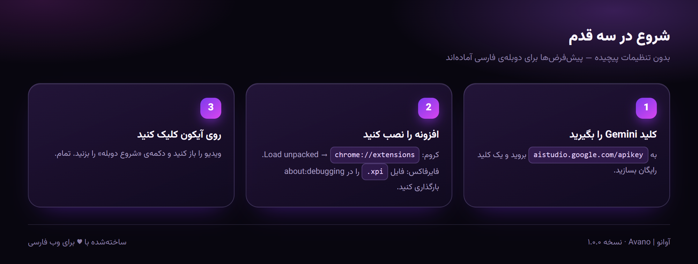
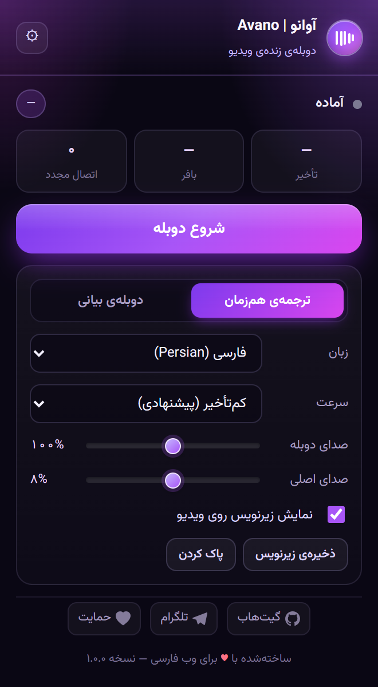
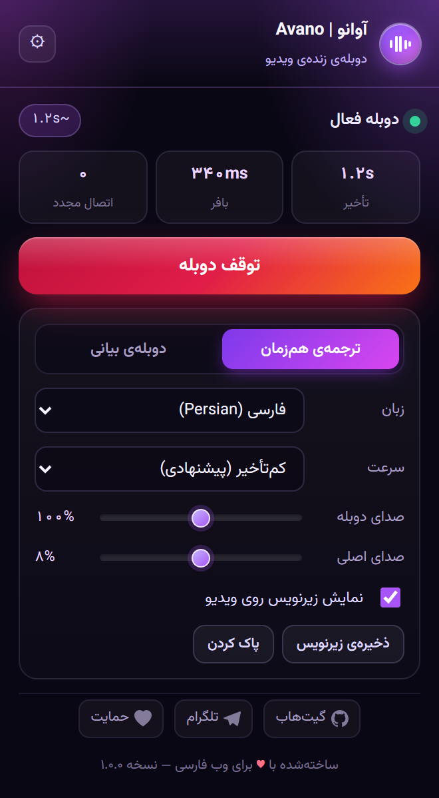
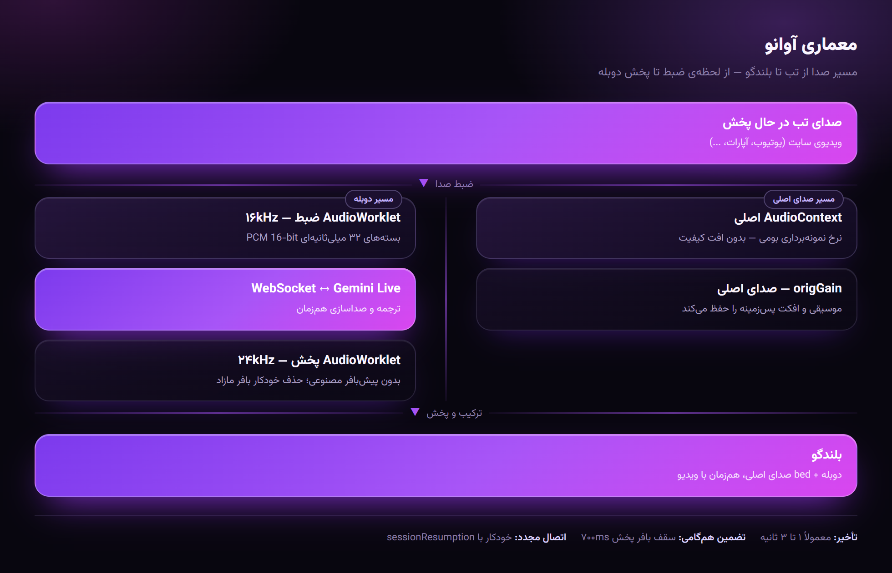
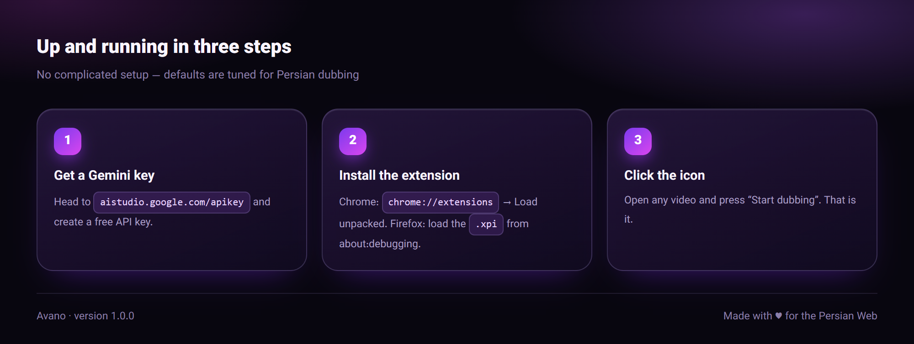
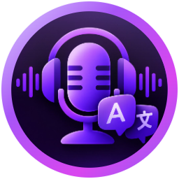
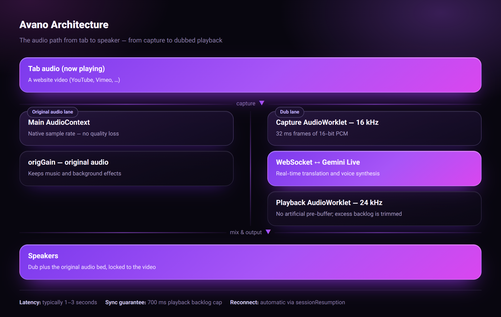

<p align="center">
  
</p>

<h1 align="center">آوانو | Avano</h1>

<p align="center">
  <strong>دوبله‌ی هم‌زمان و کم‌تأخیر ویدیوهای وب با Gemini Live API</strong><br>
  <strong>Real-time video dubbing with Gemini Live API</strong>
</p>

<p align="center">
  
  
  <a href="LICENSE"></a>
  <a href="https://github.com/ArmanAZ44/Avano/actions/workflows/ci.yml">
    
  </a>
</p>

<p align="center">
  
  
  
  
  
</p>

<p align="center">
  <a href="https://github.com/ArmanAZ44/Avano/stargazers">
    
  </a>
  <a href="https://t.me/ArmanAZPC">
    
  </a>
  <a href="https://reymit.ir/armanaz44">
    
  </a>
</p>

---

## 🌐 Languages | زبان‌ها

- [🇮🇷 فارسی (Persian)](#fa)
- [🇺🇸 English](#en)

**فهرست مطالب / Table of contents**

| فارسی | English |
|---|---|
| [شروع در سه قدم](#fa-quickstart) | [Three-step setup](#en-quickstart) |
| [قابلیت‌ها](#fa-features) | [Features](#en-features) |
| [تصاویر](#fa-screenshots) | [Screenshots](#en-screenshots) |
| [نصب](#fa-install) | [Installation](#en-install) |
| [میان‌برها](#fa-shortcuts) | [Shortcuts](#en-shortcuts) |
| [معماری فنی](#fa-architecture) | [Architecture](#en-architecture) |
| [تنظیمات پیشرفته](#fa-settings) | [Advanced settings](#en-settings) |
| [پرسش‌های پرتکرار](#fa-faq) | [FAQ](#en-faq) |
| [عیب‌یابی](#fa-troubleshooting) | [Troubleshooting](#en-troubleshooting) |
| [توسعه و مشارکت](#fa-dev) | [Development](#en-dev) |
| [نقشه‌ی راه](#fa-roadmap) | [Roadmap](#en-roadmap) |
| [مجوز](#fa-license) | [License](#en-license) |

---

<a name="fa"></a>
# 🇮🇷 آوانو — دوبله‌ی هم‌زمان ویدیو

<p align="center">
  
  
</p>

<a name="fa-quickstart"></a>
## 🚀 شروع در سه قدم

<p align="center">
  
</p>

<a name="fa-features"></a>
## ✨ قابلیت‌ها

| قابلیت | توضیح |
|--------|-------|
| **🎙️ دوبله‌ی هم‌زمان** | صدای تب گرفته می‌شود و به‌صورت استریم به Gemini می‌رود؛ پاسخ صوتی تقریباً بلافاصله پخش می‌شود. |
| **🔄 دو حالت دوبله** | «ترجمه‌ی هم‌زمان» با مدل اختصاصی (کم‌ترین تأخیر) و «دوبله‌ی بیانی» با لحن و احساس طبیعی. |
| **🎚️ ترکیب صدا** | کنترل کامل روی صدای اصلی و دوبله — موسیقی پس‌زمینه را حفظ کنید یا کاملاً قطع کنید. |
| **📜 زیرنویس دوطرفه** | متن زبان مبدأ و ترجمه‌ی مقصد هم‌زمان روی ویدیو نمایش داده می‌شوند. |
| **📊 VU متر زنده** | نمایش سطح صدای ورودی و دوبله به‌صورت زنده. |
| **⚡ پروفایل‌های تأخیر** | چهار پروفایل از «حداکثر سرعت» تا «حداکثر کیفیت» برای تنظیم یک‌جای پارامترها. |
| **🔥 گرم‌کردن اتصال** | اتصال WebSocket از قبل برقرار می‌شود تا با اولین کلیک، دوبله بلافاصله شروع شود. |
| **🪟 پاپ‌آپ ساده** | یک دکمه‌ی بزرگ شروع/توقف + زبان، حالت، صدا و زیرنویس؛ بدون تنظیمات پیچیده. |
| **🌙 پنل شناور شیشه‌ای** | طراحی Glassmorphism بنفش با فونت وزیرمتن، قابل جابه‌جایی، مقاوم در برابر CSS سایت. |
| **🎬 نشست طولانی** | فشرده‌سازی پنجره‌ی متن + اتصال مجدد خودکار برای فیلم‌های بلند. |
| **💾 خروجی زیرنویس** | متن اصلی و ترجمه با مُهر زمانی ذخیره می‌شوند؛ خروجی `.txt` از پاپ‌آپ. |
| **⌨️ میان‌بر صفحه‌کلید** | شروع/توقف دوبله و پنهان‌کردن پنل، بدون باز کردن پاپ‌آپ. |
| **🦊 مسیر جایگزین فایرفاکس** | اگر مرورگر ضبط صدای تب نداشته باشد، افزونه خودش درخواست اشتراک‌گذاری تب می‌دهد. |
| **🌍 کراس‌براوزر** | مناسب Chrome، Edge، Brave، Opera و Firefox؛ Chrome/Chromium کامل‌ترین تجربه را دارد. |

<a name="fa-screenshots"></a>
## 🖼️ تصاویر

### پاپ‌آپ افزونه (کنترل سریع)

<p align="center">
  
  
</p>

### پنل شناور روی ویدیو

<p align="center">
  
  
</p>

### صفحه‌ی تنظیمات کامل

<p align="center">
  
</p>

<a name="fa-install"></a>
## 📦 نصب

از [Releases](https://github.com/ArmanAZ44/Avano/releases) یکی از دو بسته را دانلود کنید:

| فایل | مرورگر |
|------|--------|
| `Avano-1.0.0-chrome.zip` | Chrome، Edge، Brave، Opera (Manifest V3) |
| `Avano-1.0.0-firefox.xpi` | Firefox (Manifest V2) |

### Chrome و مرورگرهای Chromium

1. فایل ZIP را استخراج کنید.
2. `chrome://extensions` را باز کنید → **Developer mode** را روشن کنید.
3. **Load unpacked** → پوشه‌ی استخراج‌شده را انتخاب کنید.
4. روی آیکون آوانو کلیک کنید → چرخ‌دنده → کلید API را وارد کنید → **تست اتصال** → **ذخیره**.
5. ویدیو را باز کنید و **شروع دوبله** را بزنید.

### Firefox

**راه اول — نصب موقت (سریع، برای امتحان کردن):**

1. `about:debugging#/runtime/this-firefox` را باز کنید.
2. **Load Temporary Add-on…** → فایل `Avano-1.0.0-firefox.xpi` را انتخاب کنید.
3. با بستن مرورگر افزونه حذف می‌شود؛ برای نصب دوباره همین کار را تکرار کنید.

**راه دوم — نصب دائمی:**

فایل `.xpi` باید امضاشده باشد. یا آن را در [addons.mozilla.org](https://addons.mozilla.org/developers/) بارگذاری کنید تا امضا شود، یا در **Firefox Developer Edition / Nightly** مقدار `xpinstall.signatures.required` را در `about:config` روی `false` بگذارید و سپس فایل را در `about:addons` → چرخ‌دنده → **Install Add-on From File…** نصب کنید.

### کلید API (هر دو مرورگر)

از [Google AI Studio](https://aistudio.google.com/apikey) یک کلید بسازید و در تنظیمات افزونه وارد کنید. کلید فقط در حافظه‌ی محلی مرورگر ذخیره می‌شود.

> **درباره‌ی Firefox:** این مرورگر `tabCapture` ندارد، پس آوانو به‌جای آن پنجره‌ی اشتراک‌گذاری تب را باز می‌کند. در آن پنجره تب را انتخاب کنید و **گزینه‌ی «اشتراک صدای تب» را تیک بزنید**، وگرنه صدایی دریافت نمی‌شود. Chrome/Chromium بهترین تجربه را می‌دهد چون صدای تب را بدون هیچ پنجره‌ی اضافه‌ای می‌گیرد.

### الزامات ارسال به addons.mozilla.org

`manifest-v2.json` این کلیدها را اعلام می‌کند، چون AMO بدون آن‌ها افزونه را رد می‌کند:

| کلید | مقدار | چرا |
|------|-------|-----|
| `browser_specific_settings.gecko.id` | `avano@armanaz44.github.io` | شناسه‌ی افزونه؛ برای امضا لازم است |
| `gecko.strict_min_version` | `142.0` | قدیمی‌ترین نسخه‌ای که اعلام جمع‌آوری داده را می‌فهمد |
| `gecko.data_collection_permissions.required` | `["websiteContent"]` | صدای تب برای ترجمه به Gemini گوگل فرستاده می‌شود |

> اگر این پروژه را فورک می‌کنید و مسیر داده را تغییر می‌دهید، این اعلام را هم به‌روز کنید — اعلام نادرست باعث رد شدن در AMO می‌شود.

برای بررسی پیش از ارسال:

```bash
npm install          # فقط بار اول، برای addons-linter
npm run build
npm run lint:firefox
```

خروجی مطلوب `0 errors, 0 warnings` است.

<a name="fa-shortcuts"></a>
## ⌨️ میان‌برها

| میان‌بر | عمل |
|---------|-----|
| `Alt + Shift + A` | باز کردن پاپ‌آپ آوانو |
| `Alt + Shift + D` | شروع یا توقف دوبله |
| `Alt + Shift + O` | پنهان یا نمایان کردن پنل شناور |

میان‌برها را می‌توانید از `chrome://extensions/shortcuts` (کروم) یا `about:addons` → چرخ‌دنده → **Manage Extension Shortcuts** (فایرفاکس) تغییر دهید.

<a name="fa-architecture"></a>
## 🏗️ معماری فنی

```
Avano/
├── manifest.json                    کروم / Chromium — Manifest V3
├── manifest-v2.json                 فایرفاکس — Manifest V2
├── package.json                     اسکریپت‌های npm (build / check)
├── LICENSE · CHANGELOG.md · CONTRIBUTING.md · SECURITY.md
├── .github/
│   ├── workflows/ci.yml             اعتبارسنجی و ساخت در هر push و PR
│   ├── workflows/release.yml        ساخت و انتشار خودکار با تگ v*
│   ├── ISSUE_TEMPLATE/              فرم‌های گزارش اشکال و درخواست قابلیت
│   └── PULL_REQUEST_TEMPLATE.md
├── assets/                          آیکون‌ها و فونت وزیرمتن
├── src/
│   ├── shared/
│   │   ├── config.js               تنظیمات، زبان‌ها، سازنده‌ی پیام‌های Gemini
│   │   ├── platform.js             حل APIهای مخصوص هر مرورگر در زمان اجرا
│   │   └── browser-api.js          پلی‌فیل کراس‌براوزر برای فایرفاکس
│   ├── background/
│   │   ├── service-worker.js       چرخه‌ی عمر، مسیریابی، میان‌برها، لاگ زیرنویس
│   │   └── background-firefox.html میزبان background در فایرفاکس (MV2)
│   ├── offscreen/
│   │   ├── offscreen.html          صفحه‌ی نامرئی برای Web Audio
│   │   ├── offscreen.js            موتور اصلی: ضبط، WebSocket، پخش
│   │   └── audio-worklets.js       پردازنده‌های AudioWorklet
│   ├── content/
│   │   ├── content.js              پنل شناور + زیرنویس + کنترل ویدیو
│   │   └── content.css             جای‌گذاری لایه‌ی پنل
│   ├── popup/                      پاپ‌آپ کنترل سریع (html / css / js)
│   └── options/                    تنظیمات کامل (html / css / js)
├── tools/
│   ├── build.mjs                    ساخت بسته‌ی کروم (zip) و فایرفاکس (xpi)
│   ├── validate.mjs                 بررسی سورس، manifestها، آیکون‌ها، تصاویر، الزامات AMO
│   ├── lint-firefox.mjs             اجرای بازرس رسمی addons.mozilla.org
│   └── make_icons.py                تولید آیکون بدون وابستگی
└── docs/img/                        تصاویر و اسکرین‌شات‌ها
```

### جریان صدا

<p align="center">
  
</p>

<details>
<summary>نمایش متنی همین نمودار</summary>

```
صدای تب ──tabCapture / getDisplayMedia──▶ MediaStream
     ├─▶ [AudioContext اصلی] ──▶ origGain ──▶ خروجی   (صدای اصلی)
     └─▶ [AudioContext 16kHz] ──▶ AudioWorklet ──▶ PCM16 ──▶ WebSocket (Gemini)

Gemini ──WebSocket──▶ PCM 24kHz ──▶ AudioWorklet پخش ──▶ dubGain ──▶ خروجی
```

</details>

<a name="fa-settings"></a>
## ⚙️ تنظیمات پیشرفته

| تنظیم | توضیح |
|-------|-------|
| **حالت دوبله** | ترجمه‌ی هم‌زمان (پیشنهادی) / دوبله‌ی بیانی |
| **زبان مقصد** | کد BCP-47 مانند `fa-IR`، `en-US`، `ar-XA` |
| **پروفایل تأخیر** | ultra / low / balanced / quality |
| **اندازه‌ی بلوک ضبط** | ۱۶ms تا ۶۴ms — کوچک‌تر = تأخیر کم‌تر |
| **سقف بافر پخش** | حذف خودکار بافر مازاد برای جلوگیری از عقب‌افتادن |
| **محدودکننده‌ی نرم** | جلوگیری از اعوجاج در حجم بالا |
| **گرم‌کردن اتصال** | باز کردن WebSocket از قبل برای شروع سریع‌تر |

<a name="fa-troubleshooting"></a>
## ❓ عیب‌یابی

| مشکل | راه‌حل |
|------|--------|
| **کلیک روی آیکون کار نمی‌کند** | صفحه باید `https://` باشد (نه `file://`). |
| **«کلید API تنظیم نشده»** | تنظیمات را باز کنید و کلید AI Studio را وارد کنید. |
| **اتصال ۱۰۰۶** | شبکه یا فیلترشکن را بررسی کنید؛ proxy را تنظیم کنید. |
| **مدل پیدا نشد** | نام مدل را در تنظیمات تغییر دهید یا proxy را بررسی کنید. |
| **تأخیر زیاد** | پروفایل «حداکثر سرعت» را انتخاب کنید و بلوک ضبط را ۱۶ms بگذارید. |
| **در فایرفاکس صدایی شنیده نمی‌شود** | در پنجره‌ی اشتراک‌گذاری، تب را انتخاب کنید و تیک «اشتراک صدای تب» را بزنید. |
| **دوبله از ویدیو عقب می‌افتد** | «سقف بافر پخش» را کم کنید (مثلاً ۴۰۰ms) تا بافر مازاد سریع‌تر حذف شود. |
| **میان‌بر کار نمی‌کند** | ممکن است با میان‌بر برنامه‌ی دیگری تداخل داشته باشد؛ از صفحه‌ی مدیریت میان‌برها تغییرش دهید. |

<a name="fa-faq"></a>
## ❓ پرسش‌های پرتکرار

<details>
<summary><b>رایگان است؟</b></summary>

خود افزونه رایگان و متن‌باز است. اما دوبله از **Gemini Live API** گوگل استفاده می‌کند که
سهمیه‌ی رایگان محدودی دارد؛ برای استفاده‌ی سنگین باید در Google AI Studio صورتحساب فعال کنید.
</details>

<details>
<summary><b>«بدون تأخیر» یعنی صفر میلی‌ثانیه؟</b></summary>

نه. در ترجمه‌ی هم‌زمان، مدل باید کمی از گفتار را بشنود تا بتواند ترجمه کند. تأخیر واقعی
معمولاً **۱ تا ۳ ثانیه** است. این نزدیک‌ترین چیزی است که امروز در مرورگر شدنی است.
</details>

<details>
<summary><b>صدای ویدیو قطع می‌شود، چرا؟</b></summary>

این عمدی است. برای اینکه فقط دوبله شنیده شود، مرورگر صدای تب را به افزونه منحرف می‌کند و
خودِ صفحه بی‌صدا می‌شود. با اسلایدر «صدای اصلی» می‌توانید موسیقی و افکت پس‌زمینه را زیر
دوبله برگردانید.
</details>

<details>
<summary><b>کلید API من کجا می‌رود؟</b></summary>

فقط در `chrome.storage.local` روی همان دستگاه. تنها مقصد شبکه‌ای
`generativelanguage.googleapis.com` است. اگر «آدرس رله» را پر کنید، کلید از رله‌ی خودتان
عبور می‌کند. جزئیات در [SECURITY.md](SECURITY.md).
</details>

<details>
<summary><b>روی موبایل کار می‌کند؟</b></summary>

نه. `chrome.tabCapture` و سند offscreen در مرورگرهای موبایل در دسترس نیستند.
</details>

<details>
<summary><b>چرا فایرفاکس پنجره‌ی اشتراک‌گذاری باز می‌کند؟</b></summary>

چون فایرفاکس `tabCapture` ندارد. افزونه با `getDisplayMedia` همان کار را می‌کند، ولی این
API نیازمند انتخاب دستی تب است. یادتان باشد تیک **«اشتراک صدای تب»** را بزنید.
</details>

<details>
<summary><b>می‌توانم زبان دیگری جز فارسی را انتخاب کنم؟</b></summary>

بله. در پاپ‌آپ یا تنظیمات، فهرست زبان‌ها را ببینید — بیش از ۲۰ زبان پشتیبانی می‌شود و
فیلد زبان مقصد قابل ویرایش است، پس هر کد BCP-47 دیگری هم می‌توانید وارد کنید.
</details>

<details>
<summary><b>زیرنویس را چطور ذخیره کنم؟</b></summary>

در پاپ‌آپ دکمه‌ی **«ذخیره‌ی زیرنویس»** یک فایل `.txt` با مُهر زمانی دانلود می‌کند.
با **«پاک کردن»** می‌توانید لاگ را صفر کنید. لاگ در حافظه‌ی موقت است و با شروع دوبله‌ی
جدید پاک می‌شود.
</details>

<a name="fa-dev"></a>
## 🛠️ توسعه و مشارکت

پیش از هر چیز، [CONTRIBUTING.md](CONTRIBUTING.md) را بخوانید. خلاصه‌ی سریع:

```bash
git clone https://github.com/ArmanAZ44/Avano.git
cd Avano

node tools/validate.mjs     # بررسی سورس، manifestها، آیکون‌ها و تصاویر README
node tools/build.mjs        # ساخت dist/Avano-<version>-chrome.zip و -firefox.xpi
```

نیازمندی: **Node.js 18+**. هیچ وابستگی npm لازم نیست — بسته‌بند ZIP با `node:zlib` نوشته شده.

| دستور | کار |
|-------|-----|
| `npm run check` | اعتبارسنجی کامل (`--strict` برای CI) |
| `npm run build` | ساخت هر دو بسته در `dist/` |
| `npm run lint:firefox` | اجرای دقیق همان بازرس addons.mozilla.org روی فایل xpi |
| `npm test` | همان اعتبارسنجی |

`npm run lint:firefox` به `addons-linter` نیاز دارد که یک وابستگی توسعه‌ی اختیاری است — یک‌بار `npm install` بزنید. این همان بازرسی است که AMO هنگام ارسال انجام می‌دهد، پس ایرادهای رد شدن (شناسه‌ی افزونه، اعلام جمع‌آوری داده، APIهای پشتیبانی‌نشده، `innerHTML` ناایمن) پیش از آپلود گرفته می‌شوند.

### اسناد پروژه

| سند | محتوا |
|-----|--------|
| [CONTRIBUTING.md](CONTRIBUTING.md) | راه‌اندازی محیط، قواعد کد، نسخه‌گذاری |
| [CHANGELOG.md](CHANGELOG.md) | تاریخچه‌ی نسخه‌ها |
| [SECURITY.md](SECURITY.md) | مدل امنیتی و گزارش آسیب‌پذیری |
| [CODE_OF_CONDUCT.md](CODE_OF_CONDUCT.md) | آیین‌نامه‌ی رفتاری |

### یکدست بودن دو مرورگر

هر فایل جدیدی که افزونه لازم دارد باید **در هر دو** `manifest.json` (کروم) و
`manifest-v2.json` (فایرفاکس) ثبت شود. `tools/validate.mjs` همه‌ی ارجاع‌های manifest را
بررسی می‌کند تا این اشتباه زودتر گرفته شود. APIهای غایب در فایرفاکس هم در
`src/shared/browser-api.js` پوش داده می‌شوند.

<a name="fa-roadmap"></a>
## 🗺️ نقشه‌ی راه

- [x] دوبله‌ی هم‌زمان با دو حالت ترجمه و دوبله‌ی بیانی
- [x] پنل شناور، پاپ‌آپ و زیرنویس دوطرفه
- [x] بسته‌ی کروم (MV3) و فایرفاکس (MV2) از یک سورس
- [x] خروجی زیرنویس و میان‌برهای صفحه‌کلید
- [ ] انتشار در Chrome Web Store
- [ ] امضا و انتشار در addons.mozilla.org
- [ ] ذخیره‌ی زیرنویس به‌صورت `.srt`
- [ ] انتخاب بلندگو/صدا در حالت دوبله‌ی بیانی
- [ ] ترجمه‌ی چندزبانه‌ی هم‌زمان (دو زبان مقصد)
- [ ] تست خودکار رابط کاربری با Playwright

ایده‌ای دارید؟ [Issue باز کنید](https://github.com/ArmanAZ44/Avano/issues/new/choose).

<a name="fa-license"></a>
## 📜 مجوز

این پروژه تحت مجوز [MIT](LICENSE) منتشر شده است — استفاده، تغییر و توزیع آزاد است،
فقط نام توسعه‌دهنده و متن مجوز را نگه دارید.

## 💜 حمایت

اگر این پروژه برایتان مفید بود، می‌توانید از طریق ریمت از توسعه‌دهنده حمایت کنید:

<p align="center">
  <a href="https://reymit.ir/armanaz44">
    
  </a>
</p>

---

<p align="center">
  <strong>ساخته‌شده با <span style="color:#fb7185">♥</span> برای وب فارسی</strong><br>
  <a href="https://t.me/ArmanAZPC">تلگرام</a> · 
  <a href="https://github.com/ArmanAZ44/Avano">گیت‌هاب</a> · 
  <a href="https://reymit.ir/armanaz44">حمایت مالی</a>
</p>

---

<a name="en"></a>
# 🇺🇸 Avano — Real-time Video Dubbing

<p align="center">
  
  
  
</p>

<a name="en-quickstart"></a>
## 🚀 Three-step setup

<p align="center">
  
</p>

<a name="en-features"></a>
## ✨ Features

| Feature | Description |
|---------|-------------|
| **🎙️ Real-time Dubbing** | Captures tab audio and streams it to Gemini; dubbed audio plays back with minimal latency. |
| **🔄 Two Dubbing Modes** | "Live Translate" uses a dedicated translation model (lowest latency); "Expressive Dub" mimics tone and emotion. |
| **🎚️ Audio Mixing** | Full control over original vs dubbed volume — keep background music or mute it completely. |
| **📜 Bilingual Subtitles** | Source language text and translation displayed simultaneously over the video. |
| **📊 Live VU Meter** | Real-time visualization of input and dub audio levels. |
| **⚡ Latency Profiles** | Four presets from "Maximum Speed" to "Maximum Quality" for one-click tuning. |
| **🔥 Connection Prewarm** | WebSocket connection established in advance so dubbing starts instantly on click. |
| **🪟 Simple Popup** | One big Start/Stop button plus language, mode, volume and subtitle toggles — no clutter. |
| **🌙 Glassmorphism UI** | Purple glassmorphism design with Vazirmatn font, draggable, immune to page CSS. |
| **🎬 Long Session Support** | Context window compression + auto-reconnect for long movies. |
| **💾 Transcript Export** | Source text and translation are saved with timestamps to a `.txt` file from the popup. |
| **⌨️ Keyboard Shortcuts** | Start/stop dubbing and hide the panel without opening the popup. |
| **🦊 Firefox Fallback Path** | When the browser has no tab-audio capture, the extension asks for tab sharing instead. |
| **🌍 Cross-browser** | Built for Chrome, Edge, Brave, Opera and Firefox; Chrome/Chromium provides the most complete experience. |

<a name="en-screenshots"></a>
## 🖼️ Screenshots

### Popup (quick controls)

<p align="center">
  
  
</p>

### Floating panel over the video

<p align="center">
  
  
</p>

### Full settings page

<p align="center">
  
</p>

### Brand assets

<p align="center">
  
</p>

High-resolution marks for forks, stores and write-ups: [`docs/img/logo-512.png`](docs/img/logo-512.png) and [`docs/img/banner.png`](docs/img/banner.png).

<a name="en-install"></a>
## 📦 Installation

Grab one of the two packages from [Releases](https://github.com/ArmanAZ44/Avano/releases):

| File | Browser |
|------|---------|
| `Avano-1.0.0-chrome.zip` | Chrome, Edge, Brave, Opera (Manifest V3) |
| `Avano-1.0.0-firefox.xpi` | Firefox (Manifest V2) |

### Chrome and Chromium browsers

1. Extract the ZIP file.
2. Open `chrome://extensions` → enable **Developer mode**.
3. Click **Load unpacked** → select the extracted folder.
4. Click the Avano icon → gear → paste your API key → **Test Connection** → **Save**.
5. Open any video and press **Start dubbing**.

### Firefox

**Option 1 — temporary install (quick, for trying it out):**

1. Open `about:debugging#/runtime/this-firefox`.
2. Click **Load Temporary Add-on…** → select `Avano-1.0.0-firefox.xpi`.
3. The add-on disappears when the browser closes; repeat to load it again.

**Option 2 — permanent install:**

The `.xpi` must be signed. Either upload it to [addons.mozilla.org](https://addons.mozilla.org/developers/) for signing, or set `xpinstall.signatures.required` to `false` in `about:config` on **Firefox Developer Edition / Nightly**, then install the file via `about:addons` → gear → **Install Add-on From File…**.

### API key (both browsers)

Create a key at [Google AI Studio](https://aistudio.google.com/apikey) and paste it into the extension settings. It is stored locally in your browser only.

> **About Firefox:** Firefox has no `tabCapture`, so Avano opens the share dialog instead. Pick the tab there and **tick "Share tab audio"** — otherwise no audio is captured. Chrome/Chromium gives the smoothest experience because it captures tab audio with no extra dialog.

### addons.mozilla.org submission requirements

`manifest-v2.json` declares these keys because AMO rejects a submission without them:

| Key | Value | Why |
|-----|-------|-----|
| `browser_specific_settings.gecko.id` | `avano@armanaz44.github.io` | Add-on ID, required for signing |
| `gecko.strict_min_version` | `142.0` | Oldest version that understands the data declaration |
| `gecko.data_collection_permissions.required` | `["websiteContent"]` | Captured tab audio is sent to Google's Gemini API for translation |

> If you fork this and change what the extension transmits, update that declaration too — an inaccurate one is a submission blocker.

To check before uploading:

```bash
npm install          # once, for addons-linter
npm run build
npm run lint:firefox
```

The expected result is `0 errors, 0 warnings`.

<a name="en-shortcuts"></a>
## ⌨️ Shortcuts

| Shortcut | Action |
|----------|--------|
| `Alt + Shift + A` | Open the Avano popup |
| `Alt + Shift + D` | Start or stop dubbing |
| `Alt + Shift + O` | Show or hide the floating panel |

Rebind them from `chrome://extensions/shortcuts` (Chrome) or `about:addons` → gear → **Manage Extension Shortcuts** (Firefox).

<a name="en-architecture"></a>
## 🏗️ Architecture

```
Avano/
├── manifest.json                    Chrome / Chromium — Manifest V3
├── manifest-v2.json                 Firefox — Manifest V2
├── package.json                     npm scripts (build / check)
├── LICENSE · CHANGELOG.md · CONTRIBUTING.md · SECURITY.md
├── .github/
│   ├── workflows/ci.yml             Validate + build on every push and PR
│   ├── workflows/release.yml        Build and publish on v* tags
│   ├── ISSUE_TEMPLATE/              Bug report and feature request forms
│   └── PULL_REQUEST_TEMPLATE.md
├── assets/                          Icons & Vazirmatn font
├── src/
│   ├── shared/
│   │   ├── config.js               Settings, languages, Gemini message builder
│   │   ├── platform.js             Resolves browser-specific APIs at runtime
│   │   └── browser-api.js          Cross-browser polyfill for Firefox
│   ├── background/
│   │   ├── service-worker.js       Lifecycle, routing, shortcuts, transcript log
│   │   └── background-firefox.html Firefox MV2 background host
│   ├── offscreen/
│   │   ├── offscreen.html          Hidden page for Web Audio
│   │   ├── offscreen.js            Audio capture, WebSocket, playback engine
│   │   └── audio-worklets.js       AudioWorklet processors
│   ├── content/
│   │   ├── content.js              Floating panel + subtitles + video control
│   │   └── content.css             Host element positioning
│   ├── popup/                      Quick-control popup (html / css / js)
│   └── options/                    Full settings page (html / css / js)
├── tools/
│   ├── build.mjs                   Builds the Chrome zip and the Firefox xpi
│   ├── validate.mjs                Checks sources, manifests, icons, images, AMO rules
│   ├── lint-firefox.mjs            Runs addons.mozilla.org's own validator
│   └── make_icons.py               Dependency-free icon generator
└── docs/img/                        Screenshots & images
```

### Audio Pipeline

<p align="center">
  
</p>

<details>
<summary>Show the same diagram as text</summary>

```
Tab Audio ──tabCapture / getDisplayMedia──▶ MediaStream
     ├─▶ [Main AudioContext] ──▶ origGain ──▶ Output   (Original audio)
     └─▶ [16kHz AudioContext] ──▶ AudioWorklet ──▶ PCM16 ──▶ WebSocket (Gemini)

Gemini ──WebSocket──▶ PCM 24kHz ──▶ Playback Worklet ──▶ dubGain ──▶ Output
```

</details>

<a name="en-settings"></a>
## ⚙️ Advanced Settings

| Setting | Description |
|---------|-------------|
| **Dubbing Mode** | Live Translate (recommended) / Expressive Dub |
| **Target Language** | BCP-47 code like `fa-IR`, `en-US`, `ar-XA` |
| **Latency Profile** | ultra / low / balanced / quality |
| **Capture Frame Size** | 16ms to 64ms — smaller = lower latency |
| **Playback Backlog Cap** | Auto-trims excess buffer to prevent drift |
| **Soft Limiter** | Prevents distortion above 100% volume |
| **Connection Prewarm** | Opens WebSocket in advance for faster start |

<a name="en-troubleshooting"></a>
## ❓ Troubleshooting

| Issue | Solution |
|-------|----------|
| **Icon click doesn't work** | Page must be `https://` (not `file://`). |
| **"API key not set"** | Open settings and enter your AI Studio key. |
| **Connection 1006** | Check network / VPN; configure proxy if needed. |
| **Model not found** | Change model name in settings or check proxy. |
| **No audio on Firefox** | In the share dialog, pick the tab and tick **Share tab audio**. |
| **The dub drifts behind the video** | Lower the **Playback Backlog Cap** (e.g. 400 ms) so excess buffer is trimmed sooner. |
| **A shortcut does nothing** | It may clash with another app; rebind it from the browser's shortcut manager. |
| **High latency** | Select "Maximum Speed" profile and set 16ms capture frame. |

<a name="en-faq"></a>
## ❓ FAQ

<details>
<summary><b>Is it free?</b></summary>

The extension itself is free and open source. Dubbing runs on Google's **Gemini Live API**,
which has a limited free tier — heavy use needs billing enabled in Google AI Studio.
</details>

<details>
<summary><b>Does "no delay" mean zero milliseconds?</b></summary>

No. Simultaneous translation needs to hear a bit of speech before it can translate.
Real-world latency is typically **1–3 seconds**. That is the closest thing achievable in a
browser today.
</details>

<details>
<summary><b>Why does the video's own audio go silent?</b></summary>

By design. To make sure you only hear the dub, the browser redirects the tab's audio into the
extension and the page itself goes silent. Use the **Original audio** slider to bring music and
background effects back underneath the dub.
</details>

<details>
<summary><b>Where does my API key go?</b></summary>

Only into `chrome.storage.local` on your own machine. The sole network destination is
`generativelanguage.googleapis.com`. If you set a **relay URL**, your key passes through that
relay. See [SECURITY.md](SECURITY.md).
</details>

<details>
<summary><b>Does it work on mobile?</b></summary>

No. `chrome.tabCapture` and offscreen documents are not available in mobile browsers.
</details>

<details>
<summary><b>Why does Firefox open a share dialog?</b></summary>

Because Firefox has no `tabCapture`. Avano uses `getDisplayMedia` instead, which requires
picking the tab manually. Remember to tick **"Share tab audio"**.
</details>

<details>
<summary><b>Can I pick a language other than Persian?</b></summary>

Yes. Open the popup or settings to see the list — over 20 languages are supported, and the
target-language field is editable, so any valid BCP-47 code works.
</details>

<details>
<summary><b>How do I save the subtitles?</b></summary>

The **Save transcript** button in the popup downloads a timestamped `.txt`. Use **Clear** to
reset the log. It lives in memory only and resets when a new dubbing session starts.
</details>

<a name="en-dev"></a>
## 🛠️ Development

Read [CONTRIBUTING.md](CONTRIBUTING.md) first. The short version:

```bash
git clone https://github.com/ArmanAZ44/Avano.git
cd Avano

node tools/validate.mjs     # check sources, manifests, icons and README images
node tools/build.mjs        # build dist/Avano-<version>-chrome.zip and -firefox.xpi
```

Requires **Node.js 18+**. The extension itself has no npm dependencies — the ZIP writer is built on `node:zlib`; only the optional AMO linter is installed via npm.

| Command | What it does |
|---------|--------------|
| `npm run check` | Full validation (`--strict` for CI) |
| `npm run build` | Build both packages into `dist/` |
| `npm run lint:firefox` | Run addons.mozilla.org's own validator over the xpi |
| `npm test` | Alias for the validation run |

`npm run lint:firefox` needs `addons-linter`, an optional dev dependency — run `npm install` once. It is the same validator AMO runs on submission, so it catches the things that get an upload rejected (add-on ID, data collection declaration, unsupported APIs, unsafe `innerHTML`) before you upload.

### Project docs

| Document | Contents |
|----------|----------|
| [CONTRIBUTING.md](CONTRIBUTING.md) | Setup, code rules, versioning |
| [CHANGELOG.md](CHANGELOG.md) | Release history |
| [SECURITY.md](SECURITY.md) | Security model and vulnerability reporting |
| [CODE_OF_CONDUCT.md](CODE_OF_CONDUCT.md) | Community guidelines |

### Keeping both browsers in sync

Every file the extension needs must be registered in **both** `manifest.json` (Chrome) and
`manifest-v2.json` (Firefox). `tools/validate.mjs` resolves every manifest reference so that
mistake is caught early. APIs Firefox lacks get a shim in `src/shared/browser-api.js`.

<a name="en-roadmap"></a>
## 🗺️ Roadmap

- [x] Real-time dubbing with translation and expressive-dub modes
- [x] Floating panel, popup and bilingual subtitles
- [x] Chrome (MV3) and Firefox (MV2) packages from one source
- [x] Transcript export and keyboard shortcuts
- [ ] Publish to the Chrome Web Store
- [ ] Sign and publish on addons.mozilla.org
- [ ] Export subtitles as `.srt`
- [ ] Voice/speaker picker for expressive-dub mode
- [ ] Simultaneous multi-target translation (two output languages)
- [ ] Automated UI tests with Playwright

Have an idea? [Open an issue](https://github.com/ArmanAZ44/Avano/issues/new/choose).

<a name="en-license"></a>
## 📜 License

Released under the [MIT](LICENSE) License — free to use, modify and distribute, as long as you
keep the copyright notice and license text.

## 💜 Support

If you found this project useful, consider supporting the developer:

<p align="center">
  <a href="https://reymit.ir/armanaz44">
    
  </a>
</p>

---

## 🙏 Credits | سپاسگزاری

| | |
|---|---|
| **موتور صدا و ترجمه** | [Gemini Live API](https://ai.google.dev/gemini-api/docs/live-api) از Google |
| **فونت** | [Vazirmatn](https://github.com/rastikerdar/vazirmatn) اثر صابر راستی‌کردار — مجوز SIL OFL 1.1 |
| **آیکون‌ها و نشان** | طراحی اختصاصی پروژه |
| **بسته‌بندی ZIP** | نوشته‌شده روی `node:zlib` — بدون وابستگی بیرونی |

ساخته و نگه‌داری‌شده توسط [Arman AZ](https://github.com/ArmanAZ44).

---

<p align="center">
  <strong>ساخته‌شده با <span style="color:#fb7185">♥</span> برای وب فارسی</strong><br>
  <strong>Made with <span style="color:#fb7185">♥</span> for the Persian Web</strong>
</p>

<p align="center">
  <a href="https://t.me/ArmanAZPC">Telegram</a> ·
  <a href="https://github.com/ArmanAZ44/Avano">GitHub</a> ·
  <a href="https://github.com/ArmanAZ44/Avano/issues/new/choose">Issues</a> ·
  <a href="https://reymit.ir/armanaz44">Support</a>
</p>

<p align="center">
  <sub>نسخه ۱.۰.۰ · Version 1.0.0 · MIT License</sub>
</p>
