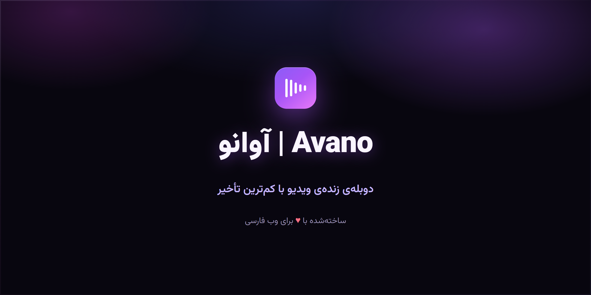
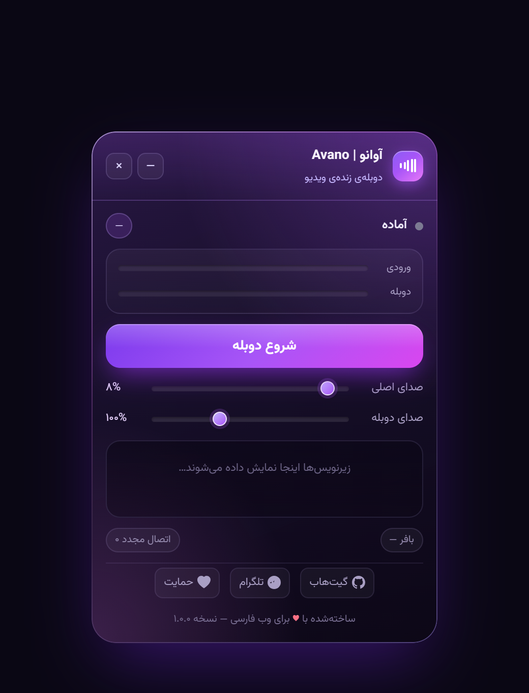
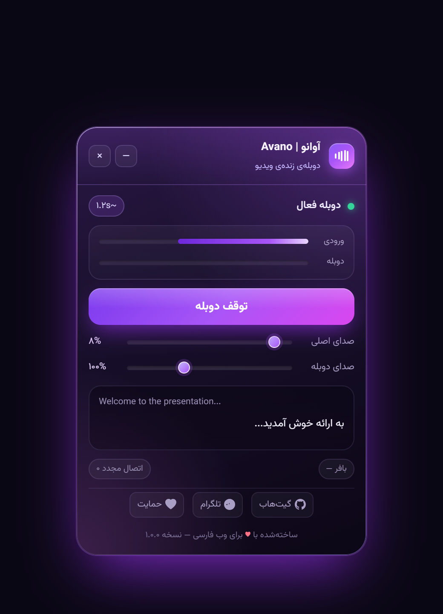
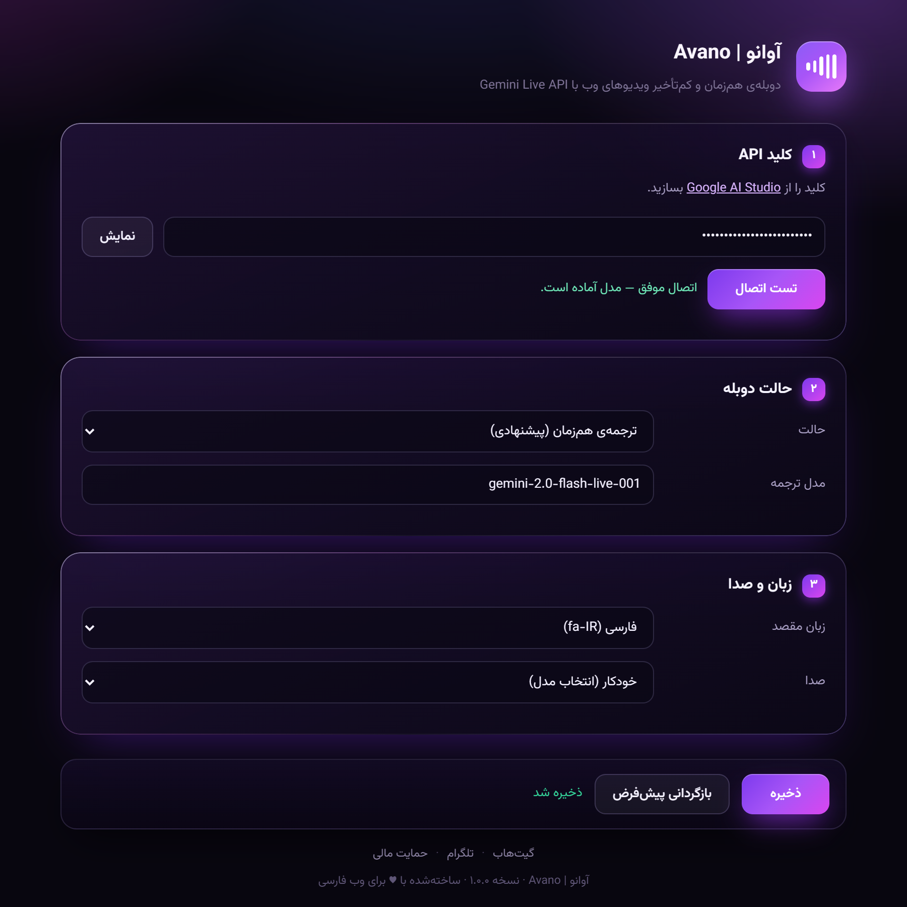

<p align="center">
  
</p>

<h1 align="center">آوانو | Avano</h1>

<p align="center">
  <strong>دوبله‌ی هم‌زمان و کم‌تأخیر ویدیوهای وب با Gemini Live API</strong><br>
  <strong>Real-time video dubbing with Gemini Live API</strong>
</p>

<p align="center">
  
  <a href="https://github.com/ArmanAZ44/Avano">
    
  </a>
  <a href="https://t.me/ArmanAZPC">
    
  </a>
  <a href="https://reymit.ir/armanaz44">
    
  </a>
</p>

---

## 🌐 Languages | زبان‌ها

- [🇮🇷 فارسی (Persian)](#🇮🇷-آوانو-—-دوبله‌ی-هم‌زمان-ویدیو)
- [🇺🇸 English](#🇺🇸-avano-—-real-time-video-dubbing)

---

<a name="🇮🇷-آوانو-—-دوبله‌ی-هم‌زمان-ویدیو"></a>
# 🇮🇷 آوانو — دوبله‌ی هم‌زمان ویدیو

<p align="center">
  
  
</p>

## ✨ قابلیت‌ها

| قابلیت | توضیح |
|--------|-------|
| **🎙️ دوبله‌ی هم‌زمان** | صدای تب گرفته می‌شود و به‌صورت استریم به Gemini می‌رود؛ پاسخ صوتی تقریباً بلافاصله پخش می‌شود. |
| **🔄 دو حالت دوبله** | «ترجمه‌ی هم‌زمان» با مدل اختصاصی (کم‌ترین تأخیر) و «دوبله‌ی بیانی» با لحن و احساس طبیعی. |
| **🎚️ ترکیب صدا** | کنترل کامل روی صدای اصلی و دوبله — موسیقی پس‌زمینه را حفظ کنید یا کاملاً قطع کنید. |
| **📜 زیرنویس دوطرفه** | متن زبان مبدأ و ترجمه‌ی مقصد هم‌زمان روی ویدیو نمایش داده می‌شوند. |
| **📊 VU متر زنده** | نمایش سطح صدای ورودی و دوبله به‌صورت زنده. |
| **⚡ پروفایل‌های تأخیر** | چهار پروفایل از «حداکثر سرعت» تا «حداکثر کیفیت» برای تنظیم یک‌جای پارامترها. |
| **🔥 گرم‌کردن اتصال** | اتصال WebSocket از قبل برقرار می‌شود تا با اولین کلیک، دوبله بلافاصله شروع شود. |
| **🌙 پنل شناور شیشه‌ای** | طراحی Glassmorphism بنفش با فونت وزیرمتن، قابل جابه‌جایی، مقاوم در برابر CSS سایت. |
| **🎬 نشست طولانی** | فشرده‌سازی پنجره‌ی متن + اتصال مجدد خودکار برای فیلم‌های بلند. |
| **🌍 کراس‌براوزر** | مناسب Chrome، Edge، Brave، Opera و Firefox؛ Chrome/Chromium کامل‌ترین تجربه را دارد. |

## 🖼️ تصاویر

<p align="center">
  
</p>

## 🚀 نصب سریع

### Chrome

1. آخرین نسخه را از [Releases](https://github.com/ArmanAZ44/Avano/releases) دانلود کنید.
2. فایل ZIP را استخراج کنید.
3. `chrome://extensions` را باز کنید → **Developer mode** روشن کنید.
4. **Load unpacked** → پوشه‌ی `Avano` را انتخاب کنید.
5. یک کلید API از [Google AI Studio](https://aistudio.google.com/apikey) بسازید.
6. از صفحه‌ی **Details** افزونه وارد **Extension options** شوید، کلید را وارد کنید → **تست اتصال** → **ذخیره**.
7. ویدیو را باز کنید و روی آیکون آوانو در نوار ابزار کلیک کنید تا دوبله شروع/توقف شود.

### Firefox

1. فایل `manifest-v2.json` را به `manifest.json` تغییر نام دهید (فایل اصلی را جایگزین کنید).
2. `about:debugging#/runtime/this-firefox` را باز کنید.
3. **Load Temporary Add-on** → فایل `manifest.json` را انتخاب کنید.

> **نکته:** در Firefox به دلیل نبود `tabCapture`، ممکن است نیاز به استفاده از رله‌ی WebSocket یا تنظیمات خاص داشته باشید.

## ⌨️ میان‌برها

| میان‌بر | عمل |
|---------|-----|
| `Alt + Shift + D` | پنهان/نمایان کردن پنل |
| کلیک روی آیکون افزونه | شروع/توقف دوبله |

## 🏗️ معماری فنی

```
Avano/
├── manifest.json                    Chrome MV3
├── manifest-v2.json                 Firefox MV2
├── assets/                          آیکون‌ها و فونت وزیرمتن
├── src/
│   ├── shared/
│   │   ├── config.js               تنظیمات، زبان‌ها، سازنده‌ی پیام‌های Gemini
│   │   └── browser-api.js          پلی‌فیل کراس‌براوزر
│   ├── background/
│   │   └── service-worker.js       چرخه‌ی عمر و مسیریابی
│   ├── offscreen/
│   │   ├── offscreen.html          صفحه‌ی نامرئی برای Web Audio
│   │   ├── offscreen.js            موتور اصلی: ضبط، WebSocket، پخش
│   │   └── audio-worklets.js       پردازنده‌های AudioWorklet
│   ├── content/
│   │   ├── content.js              پنل شناور + زیرنویس + کنترل ویدیو
│   │   └── content.css             جای‌گذاری لایه‌ی پنل
│   └── options/
│       ├── options.html            تنظیمات کامل
│       ├── options.css
│       └── options.js
└── docs/img/                        تصاویر و اسکرین‌شات‌ها
```

### جریان صدا

```
صدای تب ──tabCapture──▶ MediaStream
     ├─▶ [AudioContext اصلی] ──▶ origGain ──▶ خروجی   (صدای اصلی)
     └─▶ [AudioContext 16kHz] ──▶ AudioWorklet ──▶ PCM16 ──▶ WebSocket (Gemini)

Gemini ──WebSocket──▶ PCM 24kHz ──▶ AudioWorklet پخش ──▶ dubGain ──▶ خروجی
```

## ⚙️ تنظیمات پیشرفته

| تنظیم | توضیح |
|-------|-------|
| **حالت دوبله** | ترجمه‌ی هم‌زمان (پیشنهادی) / دوبله‌ی بیانی |
| **زبان مقصد** | کد BCP-47 مانند `fa-IR`، `en-US`، `ar-XA` |
| **پروفایل تأخیر** | ultra / low / balanced / quality |
| **اندازه‌ی بلوک ضبط** | ۱۶ms تا ۶۴ms — کوچک‌تر = تأخیر کم‌تر |
| **سقف بافر پخش** | حذف خودکار بافر مازاد برای جلوگیری از عقب‌افتادن |
| **محدودکننده‌ی نرم** | جلوگیری از اعوجاج در حجم بالا |
| **گرم‌کردن اتصال** | باز کردن WebSocket از قبل برای شروع سریع‌تر |

## ❓ عیب‌یابی

| مشکل | راه‌حل |
|------|--------|
| **کلیک روی آیکون کار نمی‌کند** | صفحه باید `https://` باشد (نه `file://`). |
| **«کلید API تنظیم نشده»** | تنظیمات را باز کنید و کلید AI Studio را وارد کنید. |
| **اتصال ۱۰۰۶** | شبکه یا فیلترشکن را بررسی کنید؛ proxy را تنظیم کنید. |
| **مدل پیدا نشد** | نام مدل را در تنظیمات تغییر دهید یا proxy را بررسی کنید. |
| **تأخیر زیاد** | پروفایل «حداکثر سرعت» را انتخاب کنید و بلوک ضبط را ۱۶ms بگذارید. |

## 🤝 مشارکت

از مشارکت شما استقبال می‌کنیم! لطفاً قبل از ارسال Pull Request یک Issue باز کنید.

## 📜 مجوز

این پروژه تحت مجوز [MIT](LICENSE) منتشر شده است.

## 💜 حمایت

اگر این پروژه برایتان مفید بود، می‌توانید از طریق ریمت از توسعه‌دهنده حمایت کنید:

<p align="center">
  <a href="https://reymit.ir/armanaz44">
    
  </a>
</p>

---

<p align="center">
  <strong>ساخته‌شده با <span style="color:#fb7185">♥</span> برای وب فارسی</strong><br>
  <a href="https://t.me/ArmanAZPC">تلگرام</a> · 
  <a href="https://github.com/ArmanAZ44/Avano">گیت‌هاب</a> · 
  <a href="https://reymit.ir/armanaz44">حمایت مالی</a>
</p>

---

<a name="🇺🇸-avano-—-real-time-video-dubbing"></a>
# 🇺🇸 Avano — Real-time Video Dubbing

<p align="center">
  
  
</p>

## ✨ Features

| Feature | Description |
|---------|-------------|
| **🎙️ Real-time Dubbing** | Captures tab audio and streams it to Gemini; dubbed audio plays back with minimal latency. |
| **🔄 Two Dubbing Modes** | "Live Translate" uses a dedicated translation model (lowest latency); "Expressive Dub" mimics tone and emotion. |
| **🎚️ Audio Mixing** | Full control over original vs dubbed volume — keep background music or mute it completely. |
| **📜 Bilingual Subtitles** | Source language text and translation displayed simultaneously over the video. |
| **📊 Live VU Meter** | Real-time visualization of input and dub audio levels. |
| **⚡ Latency Profiles** | Four presets from "Maximum Speed" to "Maximum Quality" for one-click tuning. |
| **🔥 Connection Prewarm** | WebSocket connection established in advance so dubbing starts instantly on click. |
| **🌙 Glassmorphism UI** | Purple glassmorphism design with Vazirmatn font, draggable, immune to page CSS. |
| **🎬 Long Session Support** | Context window compression + auto-reconnect for long movies. |
| **🌍 Cross-browser** | Built for Chrome, Edge, Brave, Opera and Firefox; Chrome/Chromium provides the most complete experience. |

## 🖼️ Screenshots

<p align="center">
  
</p>

## 🚀 Quick Install

### Chrome

1. Download the latest release from [Releases](https://github.com/ArmanAZ44/Avano/releases).
2. Extract the ZIP file.
3. Open `chrome://extensions` → enable **Developer mode**.
4. Click **Load unpacked** → select the `Avano` folder.
5. Get an API key from [Google AI Studio](https://aistudio.google.com/apikey).
6. Open the extension **Details** page → **Extension options**, enter the API key → **Test Connection** → **Save**.
7. Open any video and click the Avano toolbar icon to start/stop dubbing.

### Firefox

1. Rename `manifest-v2.json` to `manifest.json` (replace the original).
2. Open `about:debugging#/runtime/this-firefox`.
3. Click **Load Temporary Add-on** → select `manifest.json`.

> **Note:** Firefox lacks native `tabCapture`, so a WebSocket relay or specific setup may be needed.

## ⌨️ Shortcuts

| Shortcut | Action |
|----------|--------|
| `Alt + Shift + D` | Toggle overlay visibility |
| Click extension icon | Start / Stop dubbing |

## 🏗️ Architecture

```
Avano/
├── manifest.json                    Chrome MV3
├── manifest-v2.json                 Firefox MV2
├── assets/                          Icons & Vazirmatn font
├── src/
│   ├── shared/
│   │   ├── config.js               Settings, languages, Gemini message builder
│   │   └── browser-api.js          Cross-browser polyfill
│   ├── background/
│   │   └── service-worker.js       Lifecycle & message routing
│   ├── offscreen/
│   │   ├── offscreen.html          Hidden page for Web Audio
│   │   ├── offscreen.js            Audio capture, WebSocket, playback engine
│   │   └── audio-worklets.js       AudioWorklet processors
│   ├── content/
│   │   ├── content.js              Floating panel + subtitles + video control
│   │   └── content.css             Host element positioning
│   └── options/
│       ├── options.html            Full settings page
│       ├── options.css
│       └── options.js
└── docs/img/                        Screenshots & images
```

### Audio Pipeline

```
Tab Audio ──tabCapture──▶ MediaStream
     ├─▶ [Main AudioContext] ──▶ origGain ──▶ Output   (Original audio)
     └─▶ [16kHz AudioContext] ──▶ AudioWorklet ──▶ PCM16 ──▶ WebSocket (Gemini)

Gemini ──WebSocket──▶ PCM 24kHz ──▶ Playback Worklet ──▶ dubGain ──▶ Output
```

## ⚙️ Advanced Settings

| Setting | Description |
|---------|-------------|
| **Dubbing Mode** | Live Translate (recommended) / Expressive Dub |
| **Target Language** | BCP-47 code like `fa-IR`, `en-US`, `ar-XA` |
| **Latency Profile** | ultra / low / balanced / quality |
| **Capture Frame Size** | 16ms to 64ms — smaller = lower latency |
| **Playback Backlog Cap** | Auto-trims excess buffer to prevent drift |
| **Soft Limiter** | Prevents distortion above 100% volume |
| **Connection Prewarm** | Opens WebSocket in advance for faster start |

## ❓ Troubleshooting

| Issue | Solution |
|-------|----------|
| **Icon click doesn't work** | Page must be `https://` (not `file://`). |
| **"API key not set"** | Open settings and enter your AI Studio key. |
| **Connection 1006** | Check network / VPN; configure proxy if needed. |
| **Model not found** | Change model name in settings or check proxy. |
| **High latency** | Select "Maximum Speed" profile and set 16ms capture frame. |

## 🤝 Contributing

Contributions are welcome! Please open an Issue before submitting a Pull Request.

## 📜 License

This project is released under the [MIT](LICENSE) License.

## 💜 Support

If you found this project useful, consider supporting the developer:

<p align="center">
  <a href="https://reymit.ir/armanaz44">
    
  </a>
</p>

---

<p align="center">
  <strong>Made with <span style="color:#fb7185">♥</span> for the Persian Web</strong><br>
  <a href="https://t.me/ArmanAZPC">Telegram</a> · 
  <a href="https://github.com/ArmanAZ44/Avano">GitHub</a> · 
  <a href="https://reymit.ir/armanaz44">Support</a>
</p>
